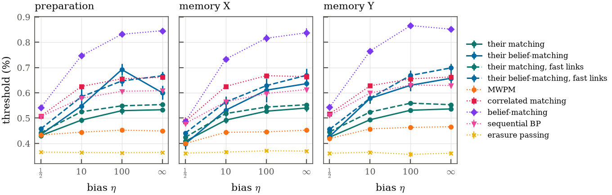
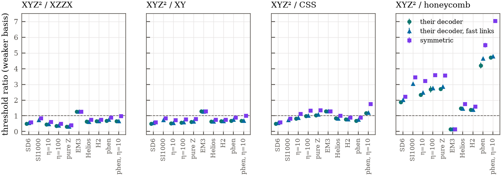

# The sequential decoder of Srivastava et al. at circuit level

Srivastava, Xiao, Frisk Kockum, Criger and Granath (arXiv:2505.03691v1, "Sequential decoding of the XYZ²
hexagonal stabilizer code", here Sri2025) decode the XYZ² code as the YZZY surface code concatenated with
the [[2,1,1]] link code. They leave the circuit-level version open ("The implementation of the sequential
decoder for circuit-level noise [...] is left for future work"). This document implements their decoder,
as they define it, on our MDR circuits, checks it against their published thresholds, and compares it with
our decoders and with the other codes.

Sources read: the arXiv HTML and PDF of v1 (14 pages): Secs. III A 1, III A 2, III B, IV, V, Appendices A to C,
Table I and Figs. 5 to 14. The authors released no code: the arXiv page lists none, and GitHub and Zenodo
searches (October 2026) found none. The reference for the phenomenological tests is therefore our own direct
implementation of their Sec. III A 2 with Table I (`tests/test_sequential_decoder.py`).

## Verdict

Implemented at circuit level, their decoder reproduces their code-capacity matching threshold (18.1(4)%
against 18.34(8)%) and, with the literal link rule fitted over their distances $d=3$ to 15, their
phenomenological thresholds, but over $d=11$ to 21 the literal rule drifts down to 3.12(13)% and 3.64(5)%,
outside both stop windows, while one matching graph per link holds 3.44(3)% and 4.00(5)%. At circuit level the
link rule matters little (the fast rule moves every threshold by at most 11%, mostly within $2\sigma$), and
under all eight noise models their decoder stays below our best XYZ² decoder: 0.76 to 0.91 of belief-matching
under seven of them and 0.96 to 0.98 of our sequential BP (within $2.2\sigma$) under EM3. Their sequential
matching beats our erasure passing by 13% to 49% and MWPM by up to 19% under bias (25% under EM3), but its hard
link decisions cost fault distance (at $d=5$ under SD6, 1,708 pairs of faults defeat it, none defeat MWPM), and
BP on the upper level cannot recover what those decisions discard. Against the other codes their decoder
changes none of our conclusions: with it the XYZ² memory stays below the XZZX and XY codes under every model but
EM3 (0.31 to 0.74 of the XZZX threshold), its threshold advantage over the CSS code under bias (1.14 to 1.35 with
our decoders) becomes a tie or a loss, and adding it to our decoders raises no XYZ² threshold. Below threshold,
at 99 qubits against 97 under $\eta=100$ and pure $Z$ noise, the XYZ² code with their decoder has 11 to 40 times
the error per round of the XZZX code with correlated matching, so their case for XYZ² under biased noise does
not survive at circuit level.

## Their decoder

**Table I.** Order the two qubits of a link as (top, bottom). With single-qubit rates $p_i,p_x,p_y,p_z$ and
link syndrome $s$, the effective YZZY Pauli of the link and its probability are

| YZZY | $s=0$ configurations | $P_{\sigma,0}$ | $s=1$ configurations | $P_{\sigma,1}$ |
|---|---|---|---|---|
| $\bar I$ | $II$, $XX$ | $(p_i^2+p_x^2)/p_0$ | $ZI$, $YX$ | $(p_zp_i+p_xp_y)/p_1$ |
| $\bar X$ | $ZZ$, $YY$ | $(p_z^2+p_y^2)/p_0$ | $IZ$, $XY$ | $(p_zp_i+p_xp_y)/p_1$ |
| $\bar Y$ | $ZY$, $YZ$ | $2p_yp_z/p_0$ | $IY$, $XZ$ | $(p_yp_i+p_xp_z)/p_1$ |
| $\bar Z$ | $XI$, $IX$ | $2p_xp_i/p_0$ | $YI$, $ZX$ | $(p_yp_i+p_xp_z)/p_1$ |

with $p_0=(p_i+p_x)^2+(p_y+p_z)^2$ and $p_1=2(p_i+p_x)(p_y+p_z)$. The $s=1$ configurations are the errors
before the correction $Z$ on the top qubit. Every entry of the PDF (page 5) agrees with this table, including
$P_{X,0}$ and $P_{Y,0}$, which the HTML renders poorly.

**Code capacity (Sec. III A 1).** Every link with a syndrome gets $Z$ on its top qubit, the plaquette
syndromes are updated, and the YZZY code is decoded with the priors of Table I (column $s$ per link).

**Phenomenological noise (Sec. III A 2).** Each of the $d^2$ links is decoded alone along time by a matching
decoder. A matched pair $r$ rounds apart is removed (measurement errors) if $q^r>p^2$ and kept as two data
errors otherwise. The links of each round are then corrected as at code capacity, and the YZZY code is
decoded over all rounds by matching ("sequential matching") or by belief-matching (BP on the upper-level YZZY
model with these priors, then matching). The link checks never enter BP, because the link decisions are hard.
Their simulations use $q=p$ for links and plaquettes.

**Their numbers.** Code capacity: depolarizing 18.34(8)% (matching), 18.52(8)% (belief-matching), 18.92(5)%
(MPS); $\eta=10$: 18.36(11)%, 24.08(5)%, 28.61(5)%. Phenomenological, $d$ rounds: depolarizing 3.42(1)% and
3.43(1)%; $\eta=10$: 3.49(2)% and 4.30(2)%. Appendix A: their sequential matching against the matching decoder
of Hetényi et al. at code capacity, 18.51(8)% against 18.27(8)% (depolarizing) and 18.64(9)% against
17.46(9)% ($\eta=10$). Each point has $5\times10^4$ samples. The legends of Figs. 8 to 13 show the
distances: $d=3$ to 25 at code capacity and $d=3$ to 15 for phenomenological noise. Threshold errors are
the covariance errors of their fit.

## The circuit-level form

Implemented in `src/mdr/ft/sequential_decoder.py` as the modes `sri_m` (sequential matching) and `sri_bm`
(sequential belief-matching) of `TwoLevelDecoder`. The steps below are the circuit form of each step of their
decoder. "Fault" means a column of the detector error model (DEM) of the combined circuit, with its prior.

1. **Link chains.** The link detectors of a link $\ell$, in time order: the $S_0$ detectors of an even link
   (round 0 against the frame, rounds 1 to $r-1$, the final frame readout) or the gauge detectors of an odd
   link (rounds 1 to $r-1$), and the repetition comparisons when `link_reps > 1`. The time edge $(t,t+1)$
   of the chain collects the faults whose link detectors are exactly $\{D_{\ell,t},D_{\ell,t+1}\}$, with total
   probability $q_{\ell,t}$. The data edge at $t$ collects the faults whose link detectors are exactly
   $\{D_{\ell,t}\}$ (the set $G_{\ell,t}$), with total probability $p_{\ell,t}$.
2. **Their rule.** The events of each chain are paired along time, with the two time ends as boundaries.
   A pair $(t_1,t_2)$ is removed if $\prod_{t=t_1}^{t_2-1}q_{\ell,t}>p_{\ell,t_1}p_{\ell,t_2}$ and kept as two
   data errors otherwise. An event paired with a time end is a data error.
   The fast form is one PyMatching graph with the time edges and a boundary edge at every link detector,
   no edge between links, and weights $\ln[(1-x)/x]$.
3. **Corrections.** Each data error $(\ell,t)$ gets $Z$ on the top qubit (upper vertex) of link $\ell$ at the
   start of round $t$, before any operation of round $t$. Its detector signature and observable flip come from
   Stim (a noiseless copy of the circuit with the one Pauli inserted), and its only link detector is checked
   to be $D_{\ell,t}$. The signatures are XORed into the detection events, the flips into the prediction, and
   the two events of each removed pair are cleared.
4. **Conditional priors (Table I at circuit level).** For a corrected $(\ell,t)$ every fault $j\in G_{\ell,t}$
   enters the upper level with its residual signature $\mathrm{sig}(j)\oplus\mathrm{sig}(Z_{\ell,t})$ and
   probability $p_j/\sum_{k\in G_{\ell,t}}p_k$. For an uncorrected $(\ell,t)$ the faults of $G_{\ell,t}$ leave.
   The faults of a time edge inside a removed pair enter with their own non-link signature and probability
   $p_j/\sum_{k\in M_{\ell,t}}p_k$; the faults of every other time edge leave. Faults without link detectors keep
   $p_j$. Any other fault with link detectors stays only if all its link detectors are corrected data errors,
   with its residual against all of those corrections and its prior.
5. **Upper level.** `sri_m`: matching on the non-link $S_0$ detectors with these per-shot priors (edges of
   probability zero are left out). `sri_bm`: product-sum BP (10 iterations, as `bm`) on every non-link
   detector ($S_0$, gauge hexagons and boundary checks) with these priors, posteriors pushed onto the $S_0$
   edges with $\tilde p_e=1-\prod_{j\ni e}(1-q_j)$, then matching. The prediction is the upper-level prediction
   XOR the flips of the corrections.

## Open choices

Their paper does not fix the following; this is what we chose.

| choice | ours |
|---|---|
| edge weights of the per-link matching | $\ln[(1-q_{\ell,t})/q_{\ell,t}]$ on time edges from the DEM; the literal rule pairs with these weights and then compares $\prod q$ with $p_{t_1}p_{t_2}$ |
| time boundaries of the per-link matching | the literal rule places a boundary one step beyond each end of the chain, at the weight of the adjacent time edge; the fast form has a boundary edge at every detector (the data edges) |
| round convention of the correction | $Z$ on the top qubit at the start of round $t$ (before the reset and gates of round $t$; for the final readout detector, after the last round) |
| weights of the upper-level 3D graph | $\ln[(1-\tilde p_e)/\tilde p_e]$ with $\tilde p_e=1-\prod_{j\ni e}(1-q_j)$ over the faults on the edge, clipped to $[10^{-12},0.5)$ as in our other matching decoders |
| hyperedges of the upper level | a non-link $S_0$ signature with more than two detectors is split as in `_setup_upper_graph` (Stim's decomposition of the $S_0$ DEM); a residual takes the symmetric difference of the splits of the fault and the correction, with components joined through the link detectors they share |
| distances | 5 to 21 at code capacity, 11 to 21 for the fits elsewhere (pilots at 5, 7, 9) |
| initial and final rounds | our circuits: noiseless frame preparation and noiseless frame readout (phen, code capacity); circuit-level models keep their own preparation and readout noise |
| failure criterion | the both-bases memories in $\bar X$ and $\bar Y$, each scored on its own observable; we report both and their minimum |
| order of Table I | complete: an uncorrected link round also brings in every pair of its data-edge faults with probability $p_jp_k$ (the $s=0$ entries $\bar X$ and $\bar Y$, of second order). The first-order version (`sri_m1`, `sri_bm1`) has no threshold, see below |
| link rule | the literal rule is the decoder as specified (`sri_m`, `sri_bm`), the fast form is `sri_m_fast`, `sri_bm_fast`; they disagree in far more than 0.1% of shots (table below); under phen the literal rule reproduces their thresholds over their distances and drifts below them at larger $d$, the fast form reproduces them at every range (validation below); the circuit-level campaign runs both |
| pairs per link round | the 16 likeliest pair signatures of every link round (`sri_pair_top=16`) in the circuit-level runs: the same $p_L$ as all pairs within the statistics, at a fifth to a ninth of the cost; under phen and code capacity a link round has at most five, so nothing is left out there |

## What the circuit form needed beyond the brief

1. **Table I to second order.** The brief's step 4 lets the faults of an uncorrected link round leave the
   upper level, which is Table I to first order. Their Table I also has the second-order entries
   $P_{X,0}=(p_z^2+p_y^2)/p_0$ and $P_{Y,0}=2p_yp_z/p_0$: two link-flipping errors on one link (for example
   $ZZ$) leave no link event and act as $\bar X$ or $\bar Y$ on the YZZY qubit. Without them the upper level
   has no edge for such an error, and the decoder has no threshold (at code capacity $p_L$ stays near 4% at
   $p=0.088$ for every $d$ from 5 to 21, against 0.17% for MWPM at $d=21$). The circuit form we use adds, for
   every uncorrected link round, every pair of its data-edge faults with their combined signature and
   probability $p_jp_k$, merged by signature (`table="full"`). Under phen this reproduces $P_{X,0}$ and
   $P_{Y,0}$ to a relative $O(p)$ (test below). The first-order version is kept as `sri_m1` and `sri_bm1`.
2. **Link detectors of round 0.** The circuit gives every round-0 detector the coordinates (0, 0, 0), so
   `TwoLevelDecoder.link_cols` marks every round-0 $S_0$ detector as a link detector whenever $S_0$ row 0 is a
   link (it is). The sequential decoder classifies the detectors itself (round-0 detectors are declared in the
   order of the $S_0$ rows). `seq_soft` and `seq_match` keep the old classification, as the brief asked to
   leave every existing decoder unchanged, so their lower level also contains the round-0 hexagon products
   (`corr_links` keeps every $S_0$ detector anyway and is not affected).
3. **Time ends of the chains.** An even link's last detector compares round $r-1$ with the noiseless frame
   readout, so no data error can flip it alone ($p_{\ell,r}=0$). An odd link's first detector compares rounds
   1 and 0 of a gauge check whose round-0 value is random, so the data edge of its first detector also holds
   the round-0 outcome flip; the same holds for its last detector, which no readout follows. The literal rule
   still calls an event paired with a time end a data error, which at an even link's readout comparison means
   a correction with no data-edge fault behind it (counted as `empty_data_edge`).

## Tests

`tests/test_sequential_decoder.py` (28 tests, all passing):

- their link rule (pairs removed when $q^r>p^2$ with $q=p$) gives the same corrections and removed pairs as
  the circuit form on 400 phen shots at $d=3$ and 5, depolarizing and $\eta=10$;
- a corrected interior link round brings in its data-edge faults with Table I's $s=1$ column, class by class
  (relative error below $4p$); an uncorrected one brings in none of them but the pairs, whose $\bar X$ and
  $\bar Y$ entries reproduce the $s=0$ column;
- the data edges at the time ends hold what the circuit puts there (above);
- every single fault of the DEM is corrected by `sri_m` and `sri_bm` at $d=3$ and 5 under SD6 and phen;
- every correction flips exactly its own link detector; at code capacity every link event is corrected.

## Link rule: literal against fast

Shots whose link decisions differ between the literal rule and the fast form (`docs/data/campaign/sri/link_rule_agreement.csv`;
$p_L$ of `sri_m` with Table I to first order on the same shots):

| model | p | d | shots | decisions differ | $p_L$ literal | $p_L$ fast | literal corrections with no data-edge fault |
|---|---|---|---|---|---|---|---|
| SD6 | 0.40% | 5 | 20,000 | 6.7% | 3.68% | 3.59% | 0 |
| SD6 | 0.40% | 7 | 20,000 | 25.8% | 5.01% | 4.97% | 0 |
| $\eta=100$ | 0.45% | 7 | 10,000 | 40.1% | 7.85% | 7.85% | 0 |
| phen | 3.6% | 5 | 20,000 | 14.5% | 6.25% | 5.52% | 1,213 |
| phen | 3.6% | 7 | 20,000 | 47.0% | 8.57% | 7.64% | 2,777 |
| phen, $\eta=10$ | 4.0% | 7 | 20,000 | 63.1% | 13.6% | 12.7% | 4,207 |

At circuit level most differences are equivalent choices (where three events in a row put the data error
first or last), and $p_L$ hardly moves. Under phen the literal rule loses at the time ends: an event at an
even link's comparison with the noiseless readout goes to the end boundary, becomes a data error with no
data-edge fault behind it, and its correction has nothing to explain it at the upper level.

## Validation against their numbers

Fits over $d=11$ to 21 (`docs/data/campaign/sri/validation.csv`); code capacity has $r=2$ (one noise layer
between two noiseless rounds), phen has $r=d$. Ours in the $\bar X$ and $\bar Y$ memories and their minimum.

| model | decoder | theirs | ours $\bar X$ | ours $\bar Y$ | min / theirs |
|---|---|---|---|---|---|
| code capacity | sequential matching (`sri_m`) | 18.34(8)% | 18.08(47)% | 18.31(35)% | 0.99 |
| code capacity | sequential belief-matching (`sri_bm`) | 18.52(8)% | drift (crossings 13 to 20%) | 17.80(133)% | |
| code capacity | `sri_bm`, $d$ BP iterations | 18.52(8)% | 17.56(135)% | 17.78(68)% | 0.95 |
| code capacity | our MWPM, BM (not sequential) | MPS 18.92(5)% | 15.78(34)%, 17.49(46)% | 16.36(120)%, 18.19(86)% | |
| code capacity, $\eta=10$ | `sri_m` | 18.36(11)% | 18.53(36)% | 18.57(59)% | 1.01 |
| code capacity, $\eta=10$ | `sri_bm` | 24.08(5)% | 22.52(92)% | 22.59(96)% | 0.94 |
| code capacity, $\eta=10$ | our MWPM, BM | MPS 28.61(5)% | 14.51(55)%, 21.62(34)% | 14.52(108)%, 22.02(50)% | |
| phen | `sri_m`, literal rule | 3.42(1)% | 3.12(13)% | 3.14(6)% | 0.91 |
| phen | `sri_m`, fast rule | 3.42(1)% | 3.44(3)% | 3.53(6)% | 1.01 |
| phen | `sri_bm`, literal rule | 3.43(1)% | 3.07(4)% | 3.17(3)% | 0.90 |
| phen | `sri_bm`, fast rule | 3.43(1)% | 3.41(9)% | 3.43(6)% | 0.99 |
| phen | `sri_bm`, $d$ BP iterations | 3.43(1)% | 3.08(5)% | 3.12(5)% | 0.90 |
| phen, $\eta=10$ | `sri_m`, literal rule | 3.49(2)% | 3.35(4)% | 3.38(2)% | 0.96 |
| phen, $\eta=10$ | `sri_m`, fast rule | 3.49(2)% | 3.66(4)% | 3.70(4)% | 1.05 |
| phen, $\eta=10$ | `sri_bm`, literal rule | 4.30(2)% | 3.64(5)% | 3.72(5)% | 0.85 |
| phen, $\eta=10$ | `sri_bm`, fast rule | 4.30(2)% | 4.00(5)% | drift (crossings 4.0 to 4.5% for $d=9$ to 19) | 0.93 |
| phen, $\eta=10$ | `sri_bm`, $d$ BP iterations | 4.30(2)% | 3.62(6)% | 3.61(7)% | 0.84 |

Our other decoders in the same phen runs (minimum over bases, docs/data/campaign/thresholds.csv): MWPM
3.25(3)%, erasure passing 3.64(5)%, sequential BP 3.84(8)%, correlated matching 3.97(4)%, belief-matching
4.09(10)%; at $\eta=10$ 3.14(4)%, 3.58(6)%, 4.05(12)%, 4.34(7)% and 5.45(4)%. Table I to first order
(`sri_m1`) gives 2.0(3)% and 2.4(1)% in phen and 10.4(13)% and 9.7(3)% at code capacity: without the
second-order column there is no proper threshold. A noisy final readout (`phen_nr`) leaves the literal-rule
thresholds where they are (3.19(5)% and 3.14(5)% depolarizing, 3.40(4)% and 3.75(5)% at $\eta=10$).

### The distances of the fit

Their fits use $d=3$ to 15 under phen (the legends of their Figs. 10 and 11), ours $d=11$ to 21. The same
finite-size fit over both ranges (`docs/data/campaign/sri/fit_range.csv`, statistical errors 0.02 to 0.05
points), in the $\bar X$ / $\bar Y$ memory:

| model | decoder | theirs | literal, $d$ 3 to 15 | literal, $d$ 11 to 21 | fast, $d$ 3 to 15 | fast, $d$ 11 to 21 |
|---|---|---|---|---|---|---|
| phen | matching | 3.42% | 3.30 / 3.52% | 3.18 / 3.21% | 3.39 / 3.64% | 3.44 / 3.48% |
| phen | belief-matching | 3.43% | 3.15 / 3.41% | 3.10 / 3.12% | 3.23 / 3.54% | 3.41 / 3.43% |
| phen, $\eta=10$ | matching | 3.49% | 3.56 / 3.68% | 3.35 / 3.38% | 3.70 / 3.85% | 3.64 / 3.66% |
| phen, $\eta=10$ | belief-matching | 4.30% | 3.93 / 4.24% | 3.68 / 3.78% | 4.15 / 4.40% | 4.06 / 4.15% |

Over their distances the literal rule lands inside both stop windows (3.30 to 3.52% for matching, 3.93 to
4.24% for belief-matching at $\eta=10$). Its threshold falls as the distances grow (belief-matching at
$\eta=10$, $\bar Y$: 4.24%, 4.03% over $d=5$ to 15, 3.78%), while that of the fast rule moves by at most
0.25 points. Their paper does not say which logical failure it counts, and our two memories differ by up to
0.3 points at $d\le15$. At code capacity the fit range changes nothing: their matching is reproduced
(17.97 to 18.76% against 18.34% and 18.36%), and their belief-matching is 4% to 8% low at every range
(17.1 to 17.8% against 18.52%, 22.0 to 22.7% against 24.08%), which places that gap in the BP step.

**Verdict of the validation.** Code capacity reproduces their matching, and their belief-matching to within
8%. Under phen the decoder as specified, with the literal link rule, reproduces their numbers when fitted
over their distances and falls outside both stop windows of the brief when fitted over ours (3.12(13)% against
the window 3.2 to 3.9%, 3.64(5)% against 3.9 to 4.8%): its threshold drifts down with the distance, which
$d\le15$ does not show. With the fast link rule the threshold is stable and reproduces theirs at both ranges
(over $d=11$ to 21: 3.44(3)% against 3.42(1)%, 3.41(9)% against 3.43(1)%, 3.66(4)% against 3.49(2)%, 4.00(5)%
against 4.30(2)%). Their numbers therefore cannot tell which of the two rules they ran, and the circuit-level
campaign runs both. Running BP for $d$ iterations instead of 10, as their Fig. 9 states, changes nothing in
phen. The order of their results holds with both rules: belief-matching ties matching for depolarizing noise
and gains at $\eta=10$ (by 9% to 15% here, 23% in their paper).

## Their comparison redone in their model

The XYZ² memory with their decoder (per basis the better of their matching and belief-matching, then the
weaker basis) against the other codes in the same phenomenological model (`docs/data/campaign/competitors.csv`,
best of MWPM, correlated MWPM and belief-matching, weaker basis), ratio XYZ² / other code and
$z=(\mathrm{XYZ^2}-\mathrm{other})/\sigma$ with statistical and systematic errors:

| model | link rule | XYZ² | XZZX 4.51(7)% / 5.54(5)% | XY 4.56(14)% / 5.37(8)% | CSS 4.57(14)% / 3.11(5)% | honeycomb 0.744(11)% / 0.773(9)% |
|---|---|---|---|---|---|---|
| depolarizing | literal | 3.12(13)% | 0.69, z −9.3 | 0.69, z −7.3 | 0.68, z −7.6 | 4.2, z +18 |
| depolarizing | fast | 3.44(3)% | 0.76, z −14 | 0.76, z −7.6 | 0.75, z −8.1 | 4.6, z +79 |
| $\eta=10$ | literal | 3.64(5)% | 0.66, z −25 | 0.68, z −19 | 1.17, z +7.4 | 4.7, z +55 |
| $\eta=10$ | fast | 3.70(4)% | 0.67, z −26 | 0.69, z −19 | 1.19, z +8.9 | 4.8, z +65 |

(The $\eta=10$ entry with the fast rule is the $\bar Y$ memory with their matching, because their
belief-matching has no finite-size fit in $\bar Y$; its $\bar X$ value 4.00(5)% would give 0.72 of XZZX.
Their own 4.30(2)% would be 0.78.) Their claim that XYZ² is "competitive with other codes tailored to biased
noise" does not survive in their own model with their own decoder: it loses to the XZZX and XY codes by 24% to
34% at more than seven standard errors, beats the CSS code only at $\eta=10$, and beats the honeycomb code.
Only full belief-matching (our `bm`, 5.45(4)% at $\eta=10$) ties the XZZX code there.

## Circuit level: their decoder against ours

The eight noise models of the main campaign, preparation and the both-bases memories ($\bar X$, $\bar Y$),
$r=d$, $d=3$ to 21 on the grids of `campaign.py`, fits over $d=11$ to 21 with the rules of the main campaign
(`docs/data/campaign/sri/circuit_decoders.csv`; our decoders from `docs/data/campaign/thresholds.csv`, same
circuits). Both link rules, 16 likeliest pairs per link round. Thresholds of the preparation, and the best of
their four variants over the best of our five decoders in each series:

| noise | `sri_m` | `sri_m`, fast | `sri_bm` | `sri_bm`, fast | MWPM | erasure passing | sequential BP | corr. matching | BM | best theirs / best ours (prep., $\bar X$, $\bar Y$) |
|---|---|---|---|---|---|---|---|---|---|---|
| SD6 | 0.431(10)% | 0.442(6)% | 0.435(12)% | 0.458(8)% | 0.433(4)% | 0.366(2)% | 0.507(7)% | 0.508(5)% | 0.542(5)% | 0.84, 0.91, 0.84 |
| SI1000 | 0.372(4)% | 0.387(5)% | 0.373(13)% | 0.389(7)% | 0.365(4)% | 0.318(2)% | 0.436(7)% | 0.437(4)% | 0.462(5)% | 0.84, 0.88, 0.90 |
| $\eta=10$ | 0.492(10)% | 0.525(5)% | 0.548(17)% | 0.58(4)% | 0.445(3)% | 0.364(4)% | 0.579(9)% | 0.625(6)% | 0.746(5)% | 0.78, 0.77, 0.76 |
| $\eta=100$ | 0.529(14)% | 0.549(9)% | 0.69(2)% | 0.65(2)% | 0.452(6)% | 0.363(3)% | 0.606(3)% | 0.656(6)% | 0.831(5)% | 0.83, 0.77, 0.77 |
| pure $Z$ | 0.533(7)% | 0.554(7)% | 0.60(3)% | 0.667(16)% | 0.449(3)% | 0.365(3)% | 0.608(6)% | 0.661(9)% | 0.845(6)% | 0.79, 0.80, 0.82 |
| EM3 | 0.312(3)% | 0.316(3)% | 0.309(7)% | 0.313(9)% | 0.2489(18)% | 0.270(2)% | 0.327(4)% | 0.314(4)% | 0.300(3)% | 0.97, 0.96, 0.98 |
| Helios | 0.315(3)% | 0.323(3)% | 0.355(10)% | 0.351(11)% | 0.2937(20)% | 0.2484(20)% | 0.360(3)% | 0.376(3)% | 0.429(3)% | 0.83, 0.85, 0.85 |
| H2 | 0.473(10)% | 0.487(7)% | 0.491(17)% | 0.517(17)% | 0.458(2)% | 0.390(4)% | 0.544(11)% | 0.559(6)% | 0.621(7)% | 0.83, 0.90, 0.85 |

Over all 24 series (preparation and both memories of the eight models):

- **Their decoder loses to ours.** The best of their four variants reaches 0.76 to 0.91 of our best decoder
  (belief-matching, once correlated matching), at $3.2\sigma$ to $10.7\sigma$, under every model but EM3. Under
  EM3 it reaches 0.96 to 0.98 of our sequential BP, within $2.2\sigma$, and ties our correlated matching and
  belief-matching.
- **Their belief-matching against our belief-matching** is 0.71 to 0.88 (0.76 to 0.91 with the fast rule),
  and 1.01 to 1.03 under EM3. Against our correlated matching it is 0.82 to 1.06.
- **Their matching is a good matching decoder.** Under every model it is 13% to 49% above our erasure
  passing, the other sequential matching decoder. It ties MWPM under SD6 and SI1000 (0.99 to 1.02) and is 3%
  to 19% above it under bias and the trapped-ion models (25% under EM3). The hard link decisions cost less
  at circuit level than the fault distance below suggests.
- **Their belief-matching over their matching** gains up to 31%, most under bias (1.30 at $\eta=100$). Under
  SD6, SI1000 and EM3 they tie.
- **The link rule.** Against the literal rule the fast rule is −1% to +7% for matching ($z\le3.9$) and −7% to
  +11% for belief-matching ($|z|\le2.1$). At circuit level most of their differing decisions are
  equivalent choices (section "Link rule" above).
- **SI1000, $\bar Y$ memory.** Neither literal-rule decoder has a finite-size fit (crossings 0.34% to 0.41%
  for $d\ge11$), as for our belief-matching in the same series. This leaves the literal rule without a
  both-bases value under SI1000.

Logical error rates of every series: `docs/figures/sri/pl_<noise>.png` (and `.pdf`).

## Circuit level: the XYZ² code against the other codes

The rules of `docs/xyz2_usefulness.md`. In each basis the XYZ² value is the best of the decoder set, then the
weaker basis is taken. The other codes are the best of MWPM, correlated MWPM and belief-matching in their
weaker basis (`docs/data/campaign/competitors.csv`). Each cell is the ratio XYZ² / other code and $z$
(`docs/data/campaign/sri/codes.csv`):

| noise | XYZ² decoders | XYZ² | / XZZX | / XY | / CSS | / honeycomb | rank of 5 |
|---|---|---|---|---|---|---|---|
| SD6 | theirs, literal | 0.408(5)% | 0.50 (−21σ) | 0.51 (−19σ) | 0.50 (−32σ) | 1.87 (+31σ) | 4 |
| SD6 | theirs, fast | 0.441(9)% | 0.54 (−18σ) | 0.55 (−16σ) | 0.54 (−26σ) | 2.02 (+25σ) | 4 |
| SD6 | ours (MWPM, corr. matching, BM) | 0.487(7)% | 0.60 (−17σ) | 0.60 (−15σ) | 0.60 (−24σ) | 2.23 (+38σ) | 4 |
| SI1000 | theirs, literal | no fit in $\bar Y$ | | | | | |
| SI1000 | theirs, fast | 0.377(7)% | 0.74 (−10σ) | 0.74 (−11σ) | 0.73 (−15σ) | 3.03 (+38σ) | 4 |
| SI1000 | ours (MWPM, corr. matching, BM) | 0.431(8)% | 0.84 (−6σ) | 0.84 (−6σ) | 0.83 (−8σ) | 3.46 (+36σ) | 4 |
| $\eta=10$ | theirs, literal | 0.53(2)% | 0.45 (−24σ) | 0.52 (−17σ) | 0.82 (−4σ) | 2.33 (+12σ) | 4 |
| $\eta=10$ | theirs, fast | 0.56(2)% | 0.48 (−24σ) | 0.55 (−17σ) | 0.87 (−3σ) | 2.47 (+15σ) | 4 |
| $\eta=10$ | ours (MWPM, corr. matching, BM) | 0.733(8)% | 0.62 (−30σ) | 0.72 (−17σ) | 1.14 (+7σ) | 3.21 (+58σ) | 3 |
| $\eta=100$ | theirs, literal | 0.61(5)% | 0.37 (−21σ) | 0.58 (−8σ) | 0.99 (−0σ) | 2.68 (+8σ) | 4 |
| $\eta=100$ | theirs, fast | 0.63(2)% | 0.38 (−33σ) | 0.60 (−12σ) | 1.02 (+0σ) | 2.76 (+16σ) | 3 |
| $\eta=100$ | ours (MWPM, corr. matching, BM) | 0.816(15)% | 0.49 (−34σ) | 0.78 (−8σ) | 1.33 (+7σ) | 3.59 (+38σ) | 3 |
| pure $Z$ | theirs, literal | 0.636(11)% | 0.31 (−22σ) | 0.61 (−21σ) | 1.03 (+1σ) | 2.71 (+33σ) | 3 |
| pure $Z$ | theirs, fast | 0.67(3)% | 0.32 (−20σ) | 0.64 (−12σ) | 1.08 (+2σ) | 2.85 (+16σ) | 3 |
| pure $Z$ | ours (MWPM, corr. matching, BM) | 0.837(17)% | 0.41 (−18σ) | 0.80 (−9σ) | 1.35 (+10σ) | 3.56 (+34σ) | 3 |
| EM3 | theirs, literal | 0.313(13)% | 1.26 (+5σ) | 1.28 (+4σ) | 1.29 (+5σ) | 0.16 (−69σ) | 2 |
| EM3 | theirs, fast | 0.31(2)% | 1.26 (+3σ) | 1.28 (+2σ) | 1.29 (+3σ) | 0.16 (−52σ) | 2 |
| EM3 | ours (MWPM, corr. matching, BM) | 0.316(5)% | 1.27 (+13σ) | 1.29 (+5σ) | 1.30 (+11σ) | 0.16 (−79σ) | 2 |
| Helios | theirs, literal | 0.342(9)% | 0.64 (−18σ) | 0.64 (−13σ) | 0.85 (−6σ) | 1.48 (+11σ) | 4 |
| Helios | theirs, fast | 0.335(15)% | 0.62 (−13σ) | 0.63 (−11σ) | 0.83 (−4σ) | 1.45 (+7σ) | 4 |
| Helios | ours (MWPM, corr. matching, BM) | 0.407(3)% | 0.76 (−18σ) | 0.76 (−11σ) | 1.01 (+1σ) | 1.76 (+36σ) | 3 |
| H2 | theirs, literal | 0.502(16)% | 0.67 (−14σ) | 0.66 (−14σ) | 0.78 (−8σ) | 1.39 (+8σ) | 4 |
| H2 | theirs, fast | 0.500(19)% | 0.66 (−12σ) | 0.65 (−12σ) | 0.78 (−7σ) | 1.38 (+7σ) | 4 |
| H2 | ours (MWPM, corr. matching, BM) | 0.574(14)% | 0.76 (−11σ) | 0.75 (−11σ) | 0.90 (−4σ) | 1.58 (+14σ) | 4 |

With their decoder the XYZ² code ranks fourth of five under SD6, SI1000, $\eta=10$, Helios and H2, above the
honeycomb code only. Under $\eta=100$ and pure $Z$ noise it ranks third or fourth and ties the CSS code. Under
EM3 it ranks second, above XZZX, XY and CSS by 26% to 29% and far below the honeycomb code, as with our
decoders. The set "ours and theirs" gives the same value as ours alone in every model: no XYZ² threshold of
`docs/xyz2_usefulness.md` moves. What their decoder changes is the margin. Under bias our decoders put the
XYZ² code 14% to 35% above the CSS code. Theirs leaves it 13% to 18% below CSS at $\eta=10$ and tied with it at
$\eta=100$ and pure $Z$. It never comes closer to the XZZX code than ours do.

## Below threshold: their XZZX argument at equal qubits

XYZ² at $d=5$ (99 qubits) against the XZZX code at $d=7$ (97 qubits), $r=3d$, weaker basis (the larger error
per round), 68% Wilson intervals; XYZ² with their decoder under both link rules against the existing XYZ²
belief-matching and correlated matching and the XZZX code with correlated matching
(`docs/data/campaign/eq/points_eps.csv`; `docs/data/campaign/sri/eq.csv`). The literal-rule runs keep every
pair column, the fast-rule runs the 16 likeliest pairs per link round, as in the campaign. Ratio of the error
per round, XYZ² / reference (above 1: XYZ² worse):

| noise | p | decoder | $\epsilon$ per round | / XYZ² BM | / XYZ² corr. matching | / XZZX corr. matching |
|---|---|---|---|---|---|---|
| $\eta=100$ | $10^{-3}$ | `sri_m` | 6.9e-06 | 3.6 [3.1, 4.2] | 1.7 [1.5, 1.9] | 18 [16, 20] |
| $\eta=100$ | $10^{-3}$ | `sri_m`, fast | 6.5e-06 | 3.4 [3.0, 4.0] | 1.6 [1.4, 1.8] | 17 [15, 19] |
| $\eta=100$ | $10^{-3}$ | `sri_bm` | 5.0e-06 | 2.6 [2.2, 3.2] | 1.2 [1.0, 1.4] | 13 [11, 15] |
| $\eta=100$ | $10^{-3}$ | `sri_bm`, fast | 4.2e-06 | 2.2 [1.9, 2.6] | 1.0 [0.9, 1.2] | 11 [10, 12] |
| $\eta=100$ | $2\times10^{-3}$ | `sri_m` | 1.4e-04 | 6.1 [5.5, 6.9] | 2.0 [1.8, 2.2] | 21 [19, 23] |
| $\eta=100$ | $2\times10^{-3}$ | `sri_m`, fast | 1.3e-04 | 5.8 [5.2, 6.5] | 1.9 [1.7, 2.1] | 20 [18, 22] |
| $\eta=100$ | $2\times10^{-3}$ | `sri_bm` | 8.2e-05 | 3.7 [3.3, 4.1] | 1.2 [1.1, 1.3] | 12 [11, 14] |
| $\eta=100$ | $2\times10^{-3}$ | `sri_bm`, fast | 8.0e-05 | 3.6 [3.2, 4.1] | 1.2 [1.0, 1.3] | 12 [11, 14] |
| $\eta=100$ | $3\times10^{-3}$ | `sri_m` | 8.5e-04 | 7.0 [6.3, 7.8] | 2.3 [2.1, 2.6] | 26 [23, 29] |
| $\eta=100$ | $3\times10^{-3}$ | `sri_m`, fast | 7.9e-04 | 6.5 [5.8, 7.2] | 2.1 [1.9, 2.4] | 24 [21, 26] |
| $\eta=100$ | $3\times10^{-3}$ | `sri_bm` | 4.1e-04 | 3.3 [3.0, 3.7] | 1.1 [1.0, 1.2] | 12 [11, 14] |
| $\eta=100$ | $3\times10^{-3}$ | `sri_bm`, fast | 3.7e-04 | 3.1 [2.7, 3.4] | 1.0 [0.9, 1.1] | 11 [10, 13] |
| pure $Z$ | $10^{-3}$ | `sri_m` | 6.1e-06 | 3.8 [3.2, 4.3] | 1.5 [1.3, 1.7] | 26 [23, 29] |
| pure $Z$ | $10^{-3}$ | `sri_m`, fast | 6.0e-06 | 3.7 [3.2, 4.3] | 1.5 [1.3, 1.6] | 25 [23, 28] |
| pure $Z$ | $10^{-3}$ | `sri_bm` | 3.4e-06 | 2.1 [1.7, 2.6] | 0.8 [0.7, 1.0] | 14 [12, 17] |
| pure $Z$ | $10^{-3}$ | `sri_bm`, fast | 3.2e-06 | 2.0 [1.7, 2.3] | 0.8 [0.7, 0.9] | 14 [12, 15] |
| pure $Z$ | $2\times10^{-3}$ | `sri_m` | 1.2e-04 | 8.0 [7.1, 8.9] | 2.1 [1.9, 2.3] | 34 [30, 38] |
| pure $Z$ | $2\times10^{-3}$ | `sri_m`, fast | 1.1e-04 | 7.2 [6.5, 8.1] | 1.9 [1.7, 2.1] | 31 [27, 34] |
| pure $Z$ | $2\times10^{-3}$ | `sri_bm` | 6.1e-05 | 4.0 [3.5, 4.4] | 1.0 [0.9, 1.2] | 17 [15, 19] |
| pure $Z$ | $2\times10^{-3}$ | `sri_bm`, fast | 5.7e-05 | 3.7 [3.3, 4.1] | 1.0 [0.9, 1.1] | 16 [14, 17] |
| pure $Z$ | $3\times10^{-3}$ | `sri_m` | 7.6e-04 | 7.2 [6.5, 8.0] | 2.3 [2.1, 2.5] | 40 [36, 44] |
| pure $Z$ | $3\times10^{-3}$ | `sri_m`, fast | 7.3e-04 | 6.9 [6.2, 7.6] | 2.2 [2.0, 2.4] | 38 [34, 42] |
| pure $Z$ | $3\times10^{-3}$ | `sri_bm` | 3.1e-04 | 2.9 [2.6, 3.2] | 0.9 [0.8, 1.0] | 16 [14, 18] |
| pure $Z$ | $3\times10^{-3}$ | `sri_bm`, fast | 3.1e-04 | 2.9 [2.6, 3.3] | 0.9 [0.8, 1.0] | 16 [14, 18] |

Their argument, that the pure-$Z$ distance of $2d^2$ suppresses logical failures near threshold under $Z$
bias, does not survive at equal qubit count with their decoder: XYZ² is 11 to 40 times worse per round than
the XZZX code, as it is with our decoders (10 to 17 times with correlated matching). Their belief-matching
matches our correlated matching on XYZ² and is 2 to 4 times worse than our belief-matching. The fast rule
lowers the error per round by at most 16% (`sri_bm` at $\eta=100$, $p=10^{-3}$), within the intervals
almost everywhere.

## Fault distance (SD6, preparation, $r=d$)

Every single fault and every pair of DEM mechanisms, decoded as one shot each
(`scripts/sri_fault_distance.py`, `docs/data/campaign/sri/fault_distance.csv`). The circuit has fault
distance $d+1$, so a decoder that keeps it corrects every pair at $d=5$; at $d=3$ some pairs fail for every
decoder.

| decoder | $d=3$: singles failing | $d=3$: pairs failing (of 119,805) | $d=5$: singles failing | $d=5$: pairs failing (of 5,757,921) |
|---|---|---|---|---|
| MWPM | 0 | 2,779 | 0 | 0 |
| correlated matching | 0 | 2,428 | 0 | 3 |
| `sri_m` (literal) | 0 | 4,787 | 0 | 1,708 |
| `sri_m` (fast) | 0 | 4,761 | 0 | 1,708 |
| `sri_bm` (literal) | 0 | 4,732 | 0 | 1,097 |
| `sri_bm` (fast) | 0 | 4,710 | 0 | 1,093 |
| `sri_m1` (Table I first order) | 0 | 5,424 | 0 | 10,687 |

Their hard link decisions lower the fault distance: at $d=5$ two faults defeat `sri_m`, where MWPM needs
three. Of the 1,708 failing pairs at $d=5$, 1,676 contain a fault that flips detectors of more than one link
(a hook through a hexagon ancilla, 1.5% of the probability of all link-flipping faults at $d=11$). Such a
fault enters the upper level only when every one of its link detectors is corrected, so when its partner
turns one of those events into a removed pair or cancels it, nothing explains it. The other 32 are two data
errors in adjacent rounds of one link, which the rule removes as one outcome flip (the mechanism of their
Fig. 14). The fast rule fails on 1,708 pairs too. Belief-matching on the upper level (16 likeliest pairs per
link round, as in the campaign) rescues a third of them and still fails on 1,097 pairs (1,093 with the fast
rule): the information it lacks is lost in the hard link decisions, before BP.

## Cost

Decode time per shot (`docs/data/campaign/sri/timing.csv`, Perlmutter CPU, one core):

| d | `sri_m` | `seq_match` | `sri_bm` | `bm` |
|---|---|---|---|---|
| 11 | 28 to 30 ms | 44 ms | 0.77 to 0.84 s | 0.85 s |
| 21 | 101 ms | 550 ms | 2.2 s | 4.1 s |

(16 likeliest pairs per link round; with all pairs `sri_bm` takes 16 to 17 s per shot at $d=21$.)

The circuit-level campaign (`scripts/campaign_sri.py tasks --part circuit --decoders sri_m sri_bm sri_m_fast
sri_bm_fast`, with the fast-rule runs at equal qubits): 8 models, preparation and both memories, four decoders,
$d=3$ to 21, budgets and targets of `campaign.py`. It produced 11,520 points in 92 pool units on 8 one-node
regular jobs. Decoding took 1,626 core-hours (`sri_m` 249, `sri_m_fast` 266, `sri_bm` 547, `sri_bm_fast` 564),
and the equal-qubit runs with the fast rule took 80. The jobs took 16.2 node-hours elapsed, against an estimate
of 22.7. Every Slurm job of this work took 30.9 node-hours elapsed (`sacct`): the development node, the debug
pools of the phenomenological and code-capacity validation, the fault distance and the campaign.

## Status

Complete. The phenomenological validation of the literal rule fell outside the stop windows of the brief over
$d=11$ to 21 and inside them over their distances (section "The distances of the fit"). After that report, the
circuit-level campaign ran with both link rules on the user's decision. Every count is under
`data/campaign/sri/` and `docs/data/campaign/sri/`. The main campaign files (`points.csv.gz`,
`thresholds.csv`, `competitors.csv`) are unchanged.

## Proposed paper text

In paper voice, for the rewrite. Values are from `docs/data/campaign/sri/`.

**sec:decoders_bias.** We also implemented the sequential decoder of \cite{Sri2025} at circuit level
(App.~\ref{app:decoders}), and under seven of our eight noise models its threshold lies between 0.76 and 0.91
of that of belief-matching on the full \XYZ{} detector error model, while under EM3 it ties our best decoder.

**app:decoders.** We also implemented the sequential decoder of \cite{Sri2025} at circuit level. Each link is
decoded alone along time: a pair of link events is removed as outcome flips when the flips are more likely
than two data errors, and every other event gets $Z$ on the top qubit of its link. The upper level then
receives the conditional probabilities of Table I of \cite{Sri2025}, computed from the detector error model,
including the second-order entries of uncorrected links, without which the decoder has no threshold. Fitted
over their distances, $d=3$ to 15, this decoder reproduces their phenomenological thresholds, 3.30(2)% and
3.52(2)% in the two logical bases against their 3.42(1)% with matching, and their code-capacity threshold,
18.0(1)% and 18.7(2)% against 18.34(8)%. Over $d=11$ to 21 its phenomenological threshold falls to 3.12(13)%. Deciding the
links with one matching graph over the time chain of each link removes this drift, giving 3.44(3)% at $d=11$ to
21, and changes the circuit-level thresholds by at most 11%. At circuit level the threshold of their
sequential matching is 13% to 49% above that of our erasure passing, and that of their belief-matching is 0.71
to 0.88 of that of belief-matching on the full detector error model, except under EM3, where the two agree.
Its hard link decisions cost fault distance: at $d=5$ two faults defeat it under SD6, where matching needs
three.

**app:comparison_thresholds.** In the phenomenological model of \cite{Sri2025} the \XYZ{} code with their
sequential decoder reaches 0.66 to 0.76 of the threshold of the XZZX code, below it by more than seven
standard errors. At circuit level their decoder raises none of our \XYZ{} thresholds. With it the \XYZ{} code
reaches 0.31 to 0.74 of the threshold of the XZZX code under the seven noise models other than EM3, and its
advantage over the CSS code under bias becomes a tie or a loss. Below threshold their decoder does not rescue
the \XYZ{} code either: at 99 qubits and $\eta=100$ or pure $Z$ noise its error per round is 11 to 40 times that
of the XZZX code at 97 qubits.
